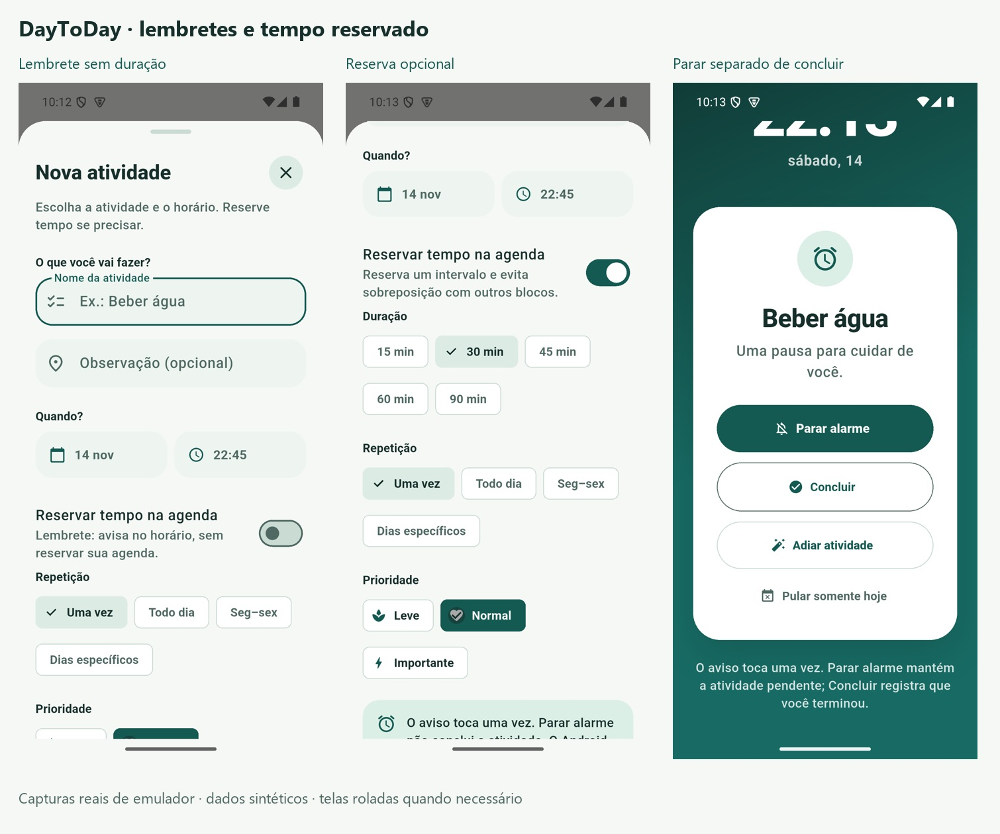

# Lembretes, reserva opcional e ações —14/11/2026

- [Lembrete padrão](lembrete.png), [reserva opcional](reservar-tempo.png)
- [Dias específicos](dias-especificos.png)
- [Ações do alarme](alarme-acoes.png), [confirmação de silêncio](silenciado.png)
- [Lista após silenciar](lista-silenciado.png), [Só pendentes](so-pendentes.png)
- [Atalho Lembrar em10min](opcoes-lembrete.png)

Capturas de dados sintéticos no Android35/360dp/fonte1x, com banco em memória e
gateways fake. Não comprovam entrega nativa; esse ensaio está separado no
[resultado Android](native-result.json). Reserva/alarme foram rolados para mostrar
as ações; relógio pode ficar parcialmente fora do viewport. Não é um mockup.

[Hashes e condições](capturas.json), [relatório e limites](../../UX_LEMBRETES_20261114.md).
O alvo opcional tool/ux_preview.dart não é importado pelo entrypoint principal.
Relógio real não é congelado. Filtro conserva progresso; remarcação que cruza dia
pode mudar o denominador daquele dia, sem concluir atividade.
