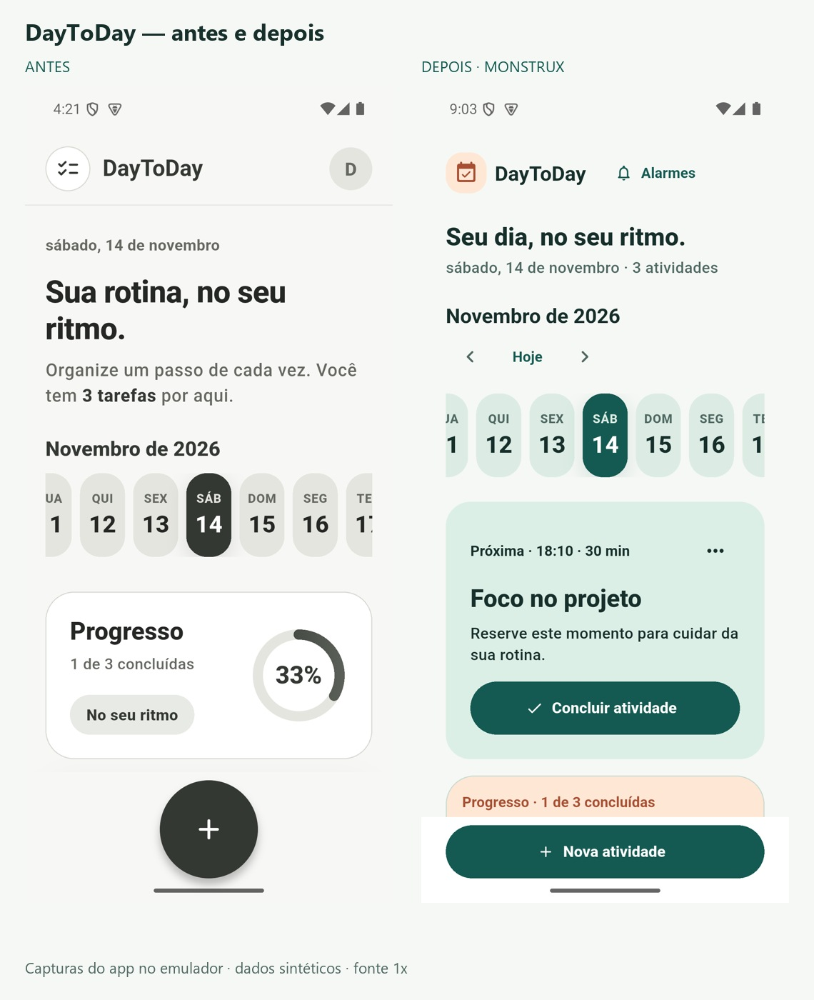

# Evidências visuais — 14/11/2026

Dados sintéticos em emulador exclusivo, modo claro, largura lógica 360dp.
O alvo opcional tool/ux_preview.dart usa banco em memória e gateways fake.
As imagens não comprovam entrega de alarmes nativos, acesso concedido,
TalkBack ou widget no launcher. Métodos e pendências estão no
[relatório](../../UX_REVIEW_20261114.md).

- [Painel, fonte 1x](painel.png)
- [Cadastro, fonte 1x](cadastro.png)
- [Alarme, fonte 1x](alarme.png)
- [Resultado após correção da barra Android](resultado.png)
- [Acessos negados simulados](acessos.png)
- [Subtarefas, fonte 2x e teclado](subtarefas-2x-teclado.png)

[Metadados e hashes](capturas.json). Horários nativos/formulário/resultado
continuam reais; os dados de atividades e instante da fixture foram fixados.
Capturas baseline v1/v2 foram descartadas por cache; a comparação usa v3.
As capturas principais antecedem o ajuste isolado de overlay. Alarme/resultado
foram recapturados depois. A comparação não mede tempo de execução nem igualdade
de pixels. O pacote completo de entrega inclui os originais separados antes/depois.
